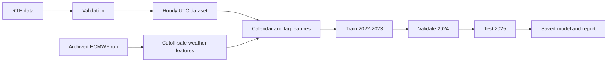
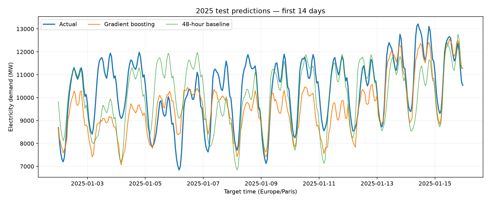

# EnergyAI

EnergyAI predicts hourly electricity demand for the next day in
**Île-de-France** using official RTE data.

At 18:00 Europe/Paris, the system prepares a forecast for every hour of the
following local day. Demand is expressed in MW. Archived weather inputs come
from forecasts that were available before that issue time.

## Current version

The project currently includes:

- RTE data download, caching, and validation
- UTC hourly demand built from half-hour measurements
- Missing-period, duplicate, and DST handling
- Calendar features and cutoff-safe 48h, 168h, and 336h lags
- Ridge regression and histogram gradient boosting
- Chronological train, validation, and test periods
- MAE, RMSE, and WAPE evaluation against naïve baselines
- Saved model artifacts, charts, metrics, and a model card
- Archived ECMWF forecast-run download and checksum caching
- Temperature, precipitation, and wind aligned to each target UTC hour
- Strict rejection of weather published after the demand forecast cutoff
- 37 automated tests

## Pipeline



## Held-out 2025 results

All models use the same 8,732 test timestamps.

| Model | MAE | RMSE | WAPE |
|---|---:|---:|---:|
| 48-hour baseline | 632.72 MW | 846.38 MW | 8.44% |
| Weekly baseline | 615.63 MW | 930.86 MW | 8.21% |
| Ridge | 447.13 MW | 601.51 MW | 5.96% |
| Histogram gradient boosting | **434.18 MW** | 634.00 MW | **5.79%** |



## Run locally

```powershell
git clone https://github.com/HassaneAitAhmed/EnergyAI.git
cd EnergyAI

py -3 -m venv .venv
.\.venv\Scripts\python.exe -m pip install -r requirements.txt

.\.venv\Scripts\python.exe -m energyai.collect --year 2022
.\.venv\Scripts\python.exe -m energyai.collect --year 2023
.\.venv\Scripts\python.exe -m energyai.collect --year 2024
.\.venv\Scripts\python.exe -m energyai.collect --year 2025

.\.venv\Scripts\python.exe -m energyai.phase2 --year 2024
.\.venv\Scripts\python.exe -m energyai.phase3
.\.venv\Scripts\python.exe -m energyai.phase4 --start-date 2024-06-02 --end-date 2024-06-04
.\.venv\Scripts\python.exe -m pytest -q
```

## Main outputs

```text
artifacts/models/best_model.joblib
reports/phase3/test_metrics.json
reports/phase3/test_predictions.png
reports/phase3/error_slices.csv
reports/phase3/model_card.md
reports/phase3/reproducibility.json
reports/phase4/weather_sample_summary.json
```

## Project structure

```text
energyai/       demand, weather, features, baselines, and models
notebooks/      exploratory data analysis
reports/        generated metrics, figures, and model documentation
artifacts/      trained model files
tests/          offline automated tests
```

Data sources:

- [RTE/ODRÉ éCO2mix](https://odre.opendatasoft.com/explore/dataset/eco2mix-regional-cons-def/)
- [Open-Meteo Single Runs API](https://open-meteo.com/en/docs/single-runs-api)
